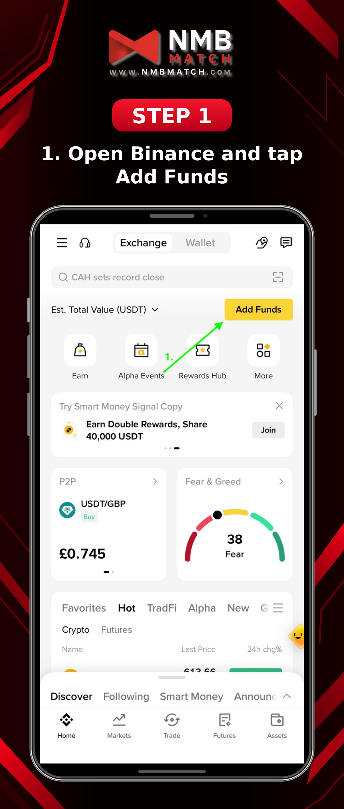
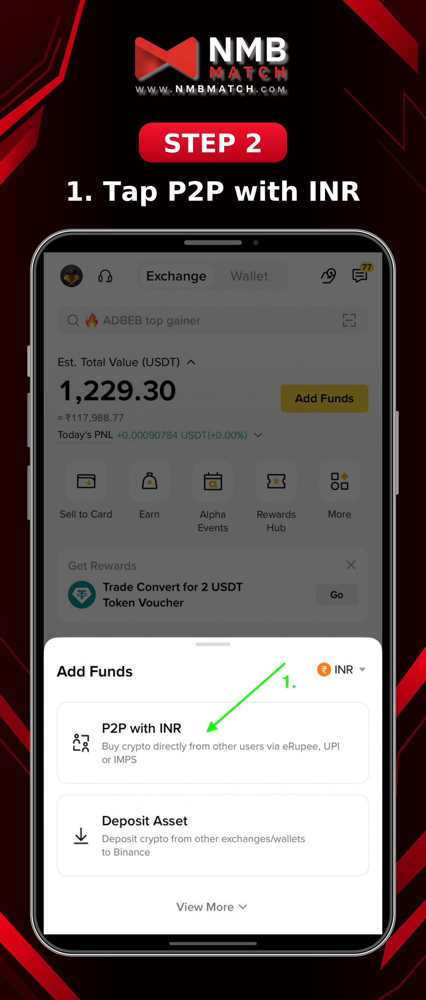
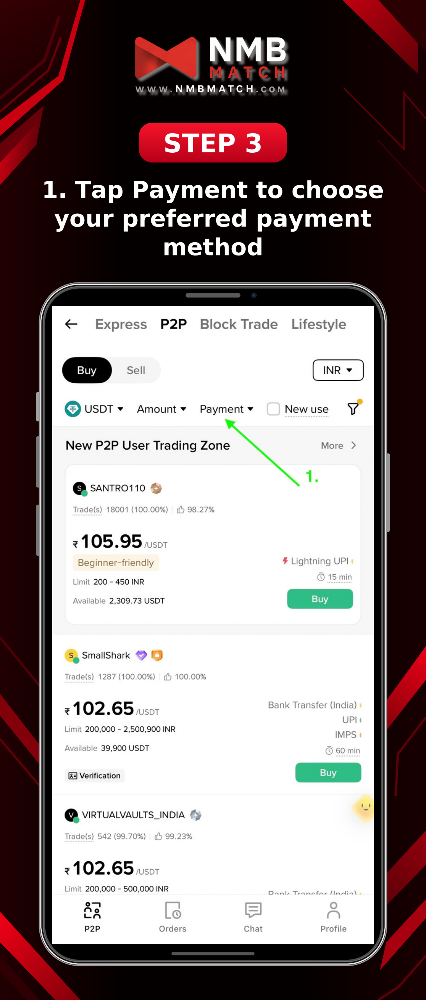
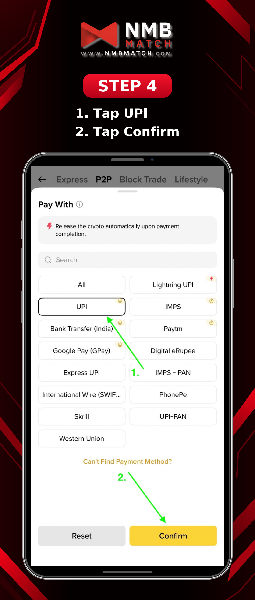
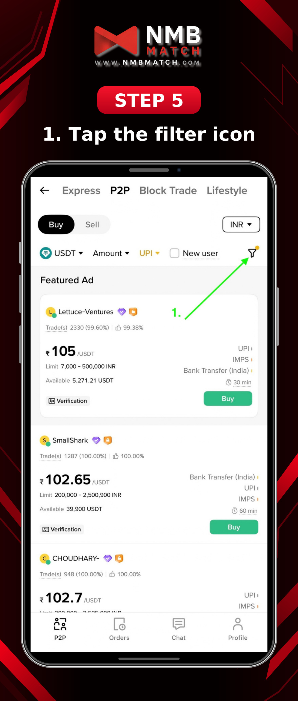
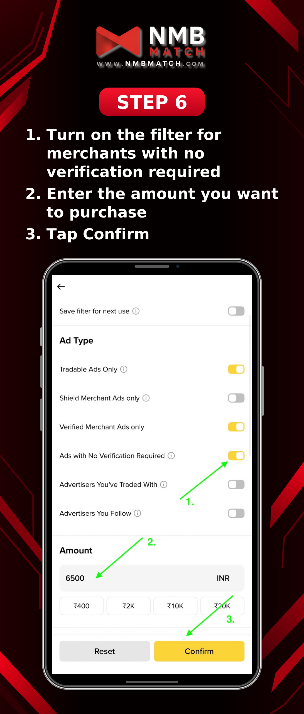
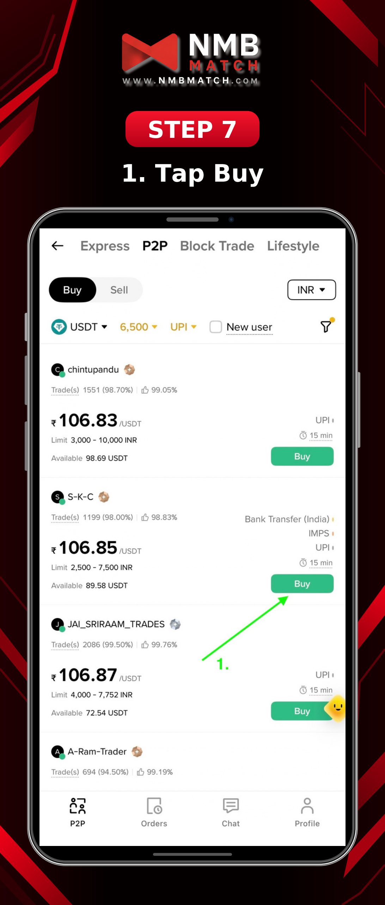
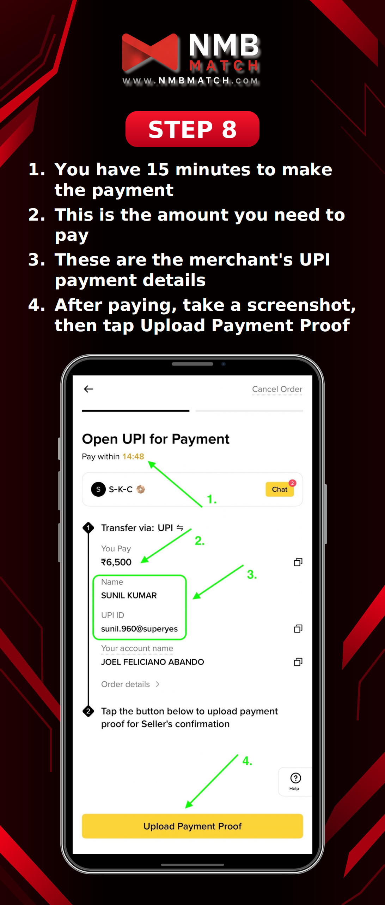
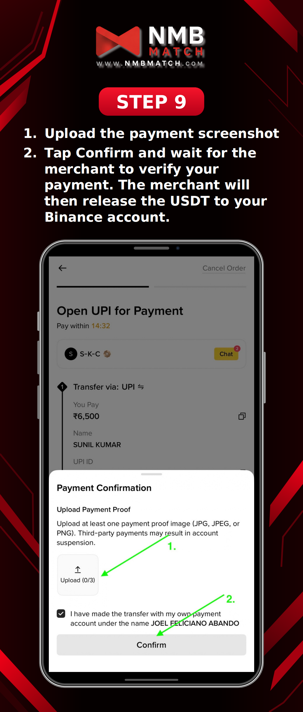

**Screenshot examples:** Use your own account and payment details. Copy wallet addresses from your current account, never from an image. Fees, limits, and available options may differ.

This example shows a Binance P2P purchase using INR and UPI. Use the currency and payment methods available to your account, and complete any verification required by Binance.

## Step 1: Open Add Funds

Open the Binance app and tap **Add Funds**.

## Step 2: Open P2P trading

Tap **P2P with INR**, as shown in the example. On the P2P screen, use the **Buy** tab and select **USDT**.

## Step 3: Open the payment filter

Tap **Payment** to choose the payment method you want to use.

## Step 4: Select UPI

Select **UPI**, then tap **Confirm**. If you use another available payment method, select that method instead.

## Step 5: Open additional filters

Tap the **filter icon** on the P2P listings screen.

## Step 6: Set your purchase amount

1. Enter the amount you want to spend in the currency shown by the filter.
2. Apply any relevant merchant filters, then tap **Confirm**.

The reference image enables a filter for merchants that do not require additional verification. Treat this as an optional listing filter; it does not remove Binance's own identity or security verification requirements.

## Step 7: Choose a seller

Review the seller's price, order limits, payment method, and trade terms. Tap **Buy** on the listing you choose. Review any order details presented before proceeding to payment.

## Step 8: Make the payment

1. Check the amount due and the seller's payment details on the active order.
2. Pay using the selected method before the order's displayed deadline.
3. Save a screenshot or receipt of your completed payment.
4. Return to the order and tap **Upload Payment Proof**, as shown in the guide.

The supplied example shows a 15-minute payment window. Use the countdown on your own order. Only mark a payment as made after you have actually paid.

## Step 9: Submit proof and check receipt of USDT

1. Upload the payment screenshot or receipt.
2. Read the payment declaration and select its checkbox only if it is accurate, including that you paid from your own account.
3. Tap **Confirm**.
4. Wait for the seller to verify payment and release the USDT.
5. Check the completed order and your Binance balance to confirm the USDT arrived.

If payment was made but the order does not complete, use the support or appeal options within the Binance order.

