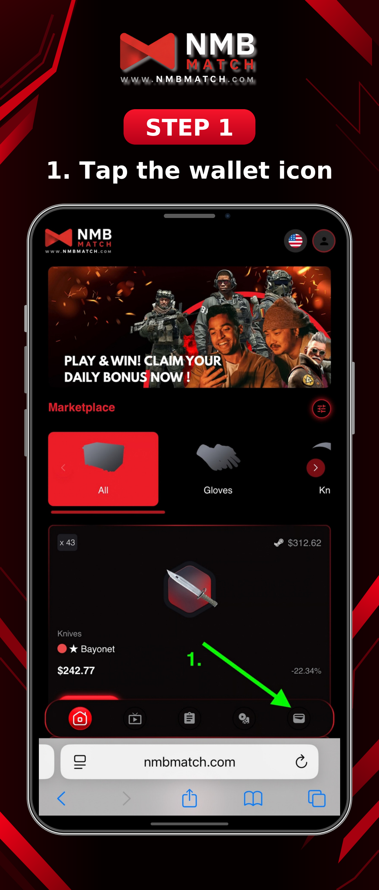
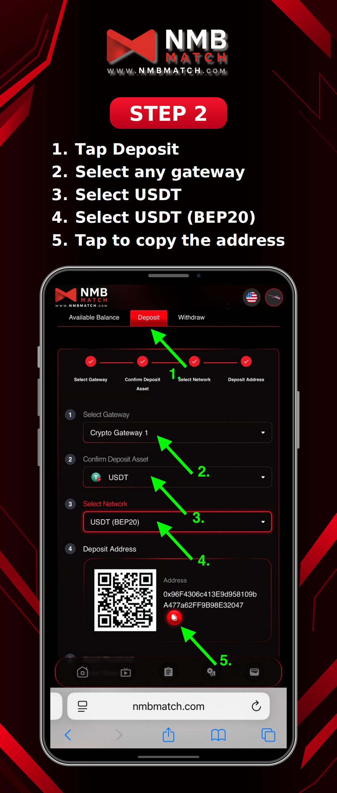
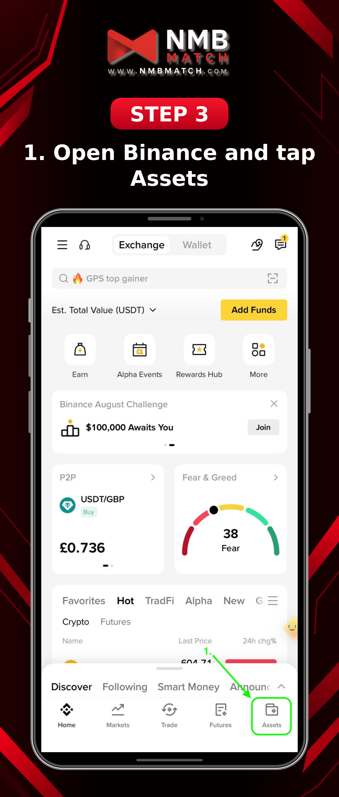
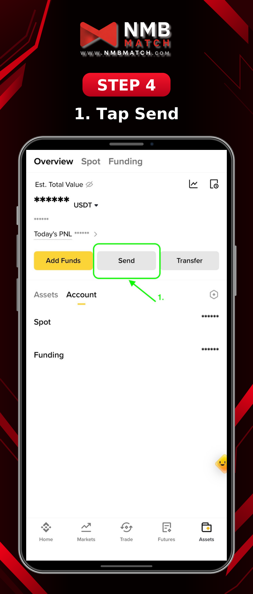
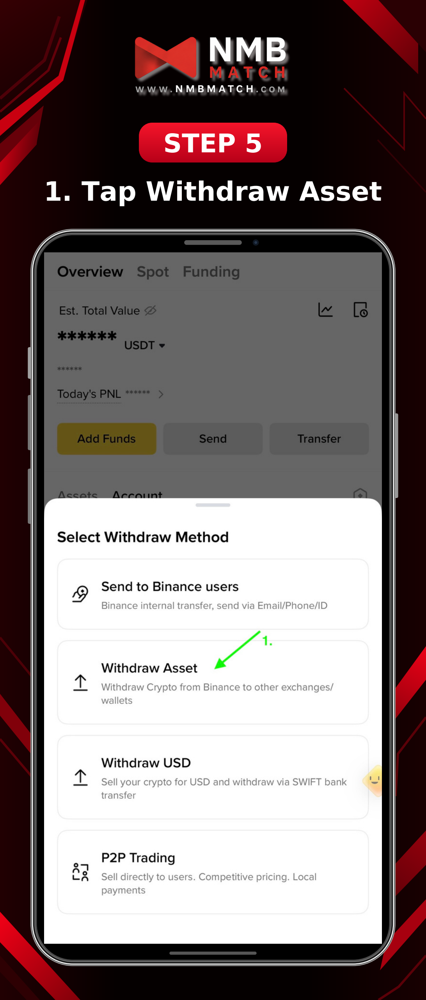
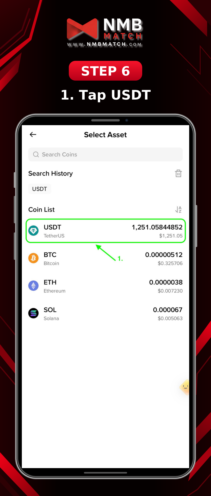
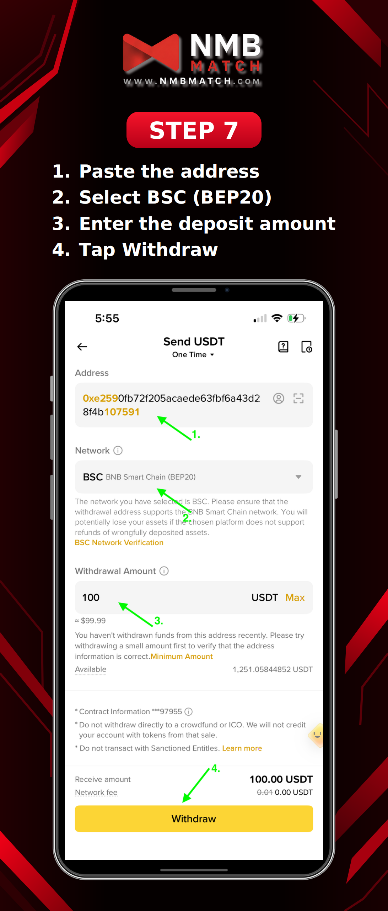
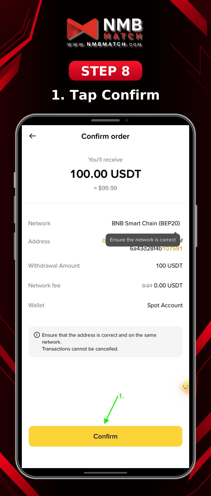
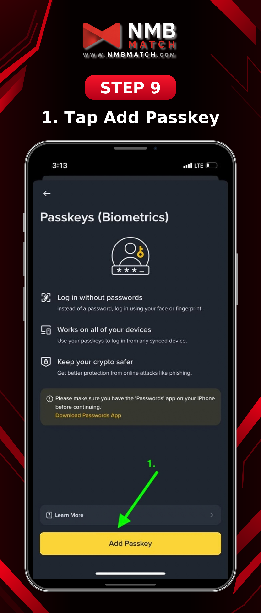
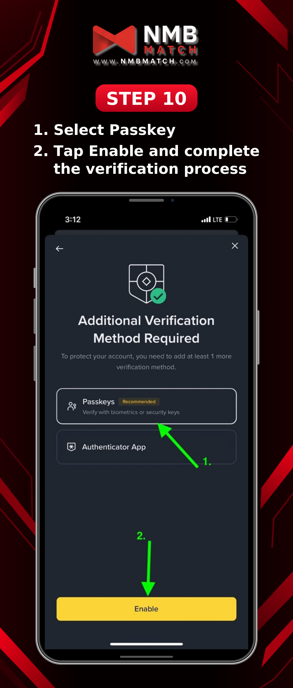

**Screenshot examples:** Use your own account and payment details. Copy wallet addresses from your current account, never from an image. Fees, limits, and available options may differ.

This tutorial shows a transfer **from Binance to NMB MATCH**. A withdrawal from Binance is a deposit into NMB MATCH.

**Before you send:** The asset and network must match on both platforms. The example uses **USDT (BEP20)** in NMB MATCH and **BSC (BEP20)** in Binance. Verify that your current destination supports this network. An incompatible network or incorrect address can cause loss of funds. See [Binance's deposit and withdrawal guidance](https://www.binance.com/en/support/faq/detail/85a1c394ac1d489fb0bfac0ef2fceafd).

## Step 1: Open your NMB MATCH wallet

In NMB MATCH, tap the **wallet icon**.

## Step 2: Copy your deposit address

1. Tap **Deposit**.
2. Select an available gateway that supports the asset and network you will use.
3. Select **USDT**.
4. Select **USDT (BEP20)** for this example.
5. Tap the copy icon to copy the deposit address from your account.

## Step 3: Open Binance Assets

Open the Binance app and tap **Assets**.

## Step 4: Start a transfer

Tap **Send**.

## Step 5: Choose a crypto withdrawal

Tap **Withdraw Asset**, as shown in the supplied screen.

## Step 6: Select USDT

Choose **USDT** from the asset list.

## Step 7: Enter the transfer details

1. Paste the NMB MATCH deposit address copied in Step 2.
2. Select **BSC (BEP20)** to match the destination network.
3. Enter the amount of USDT to send.
4. Check the address, network, fee, and amount the destination will receive.
5. Tap **Withdraw**.

## Step 8: Review and confirm

Check the transfer summary carefully. If the details are correct, tap **Confirm**.

## Step 9: Follow the security prompt

The supplied example prompts the user to tap **Add Passkey**. If Binance shows this setup screen, follow its instructions. If your account already has a verification method, complete the security checks presented to you.

## Step 10: Complete verification and check the deposit

In the example, select **Passkey**, tap **Enable**, and complete the verification process. Follow any remaining prompts to finish submitting the transfer.

Check the withdrawal status in Binance and then the deposit or balance in NMB MATCH. Completing a security prompt alone does not confirm that the funds have arrived.

