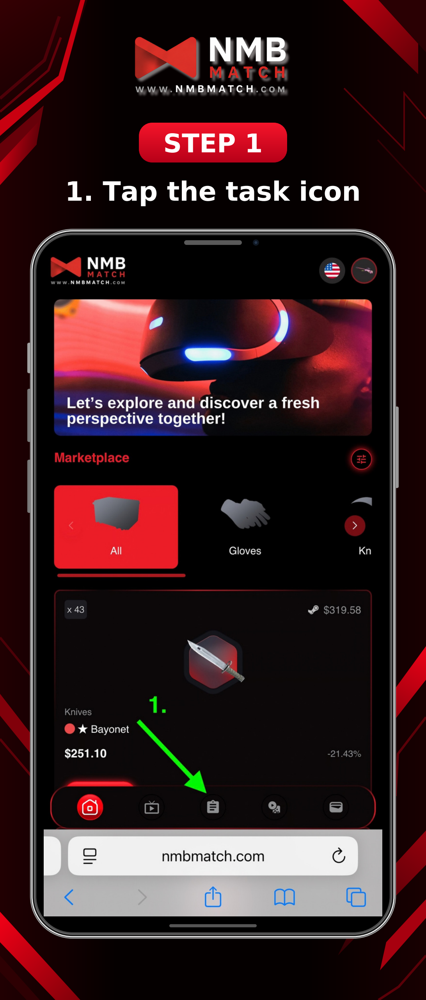
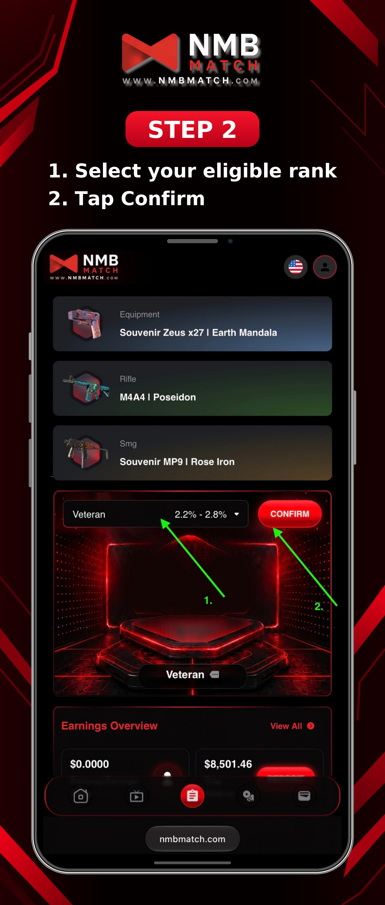
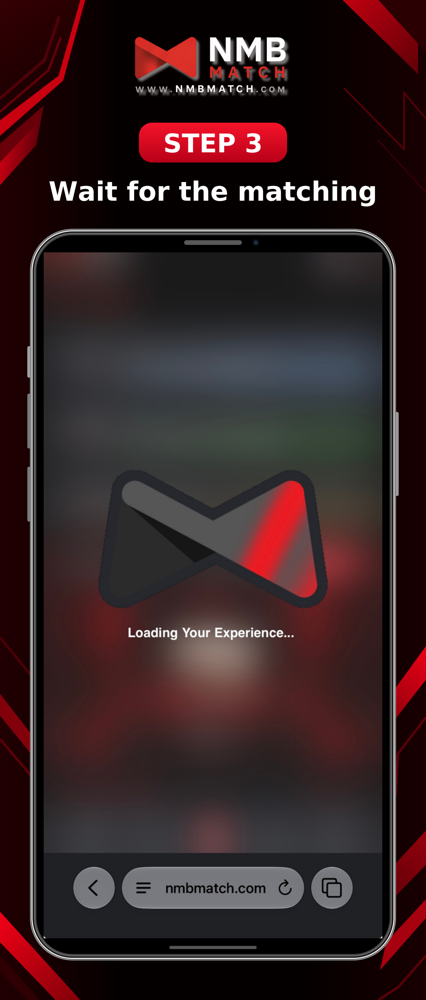
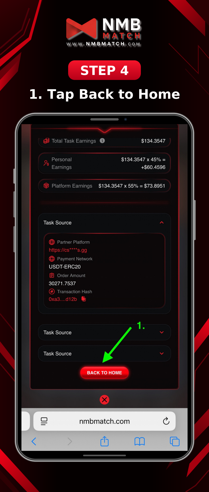

**Screenshot examples:** Use your own account and payment details. Copy wallet addresses from your current account, never from an image. Fees, limits, and available options may differ.

The supplied task guide shows four screens: open Tasks, select a rank, wait for matching, and return home. Use the rank available to your account. Amounts and percentages visible in the screenshots are examples, not promised results.

## Step 1: Open Tasks

In NMB MATCH, tap the **task icon**.

## Step 2: Choose an eligible rank

1. Open the rank selector and select a rank for which your account is eligible.
2. Review the information displayed for that rank.
3. Tap **Confirm** to proceed.

## Step 3: Wait for matching

Wait for the matching process to finish and for the result screen to appear.

## Step 4: Return to the home screen

Review the result displayed, then tap **Back to Home**.

