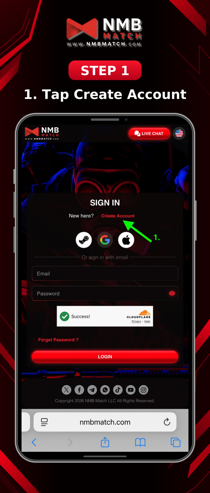
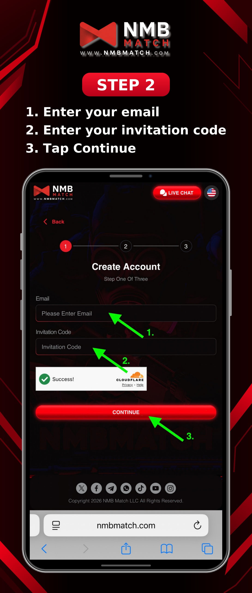
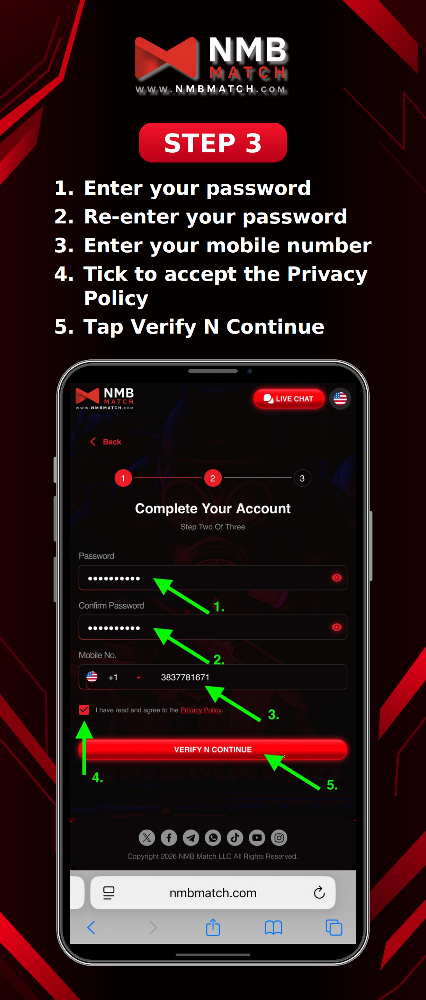
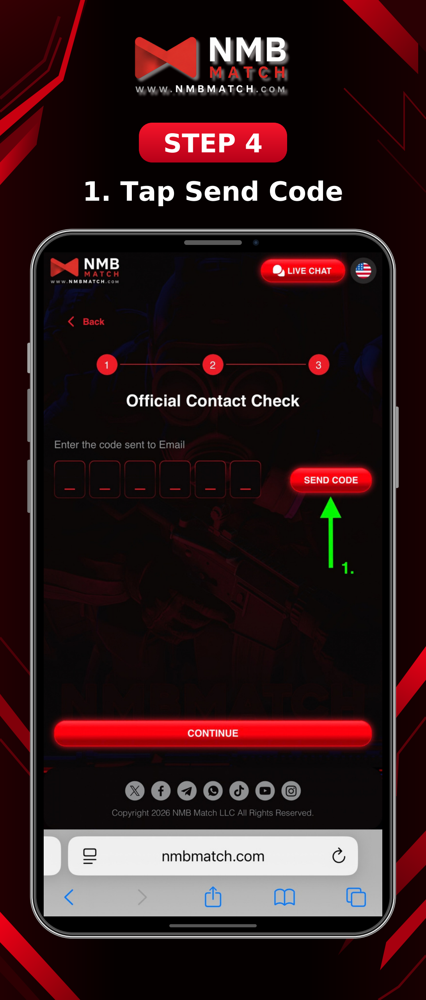
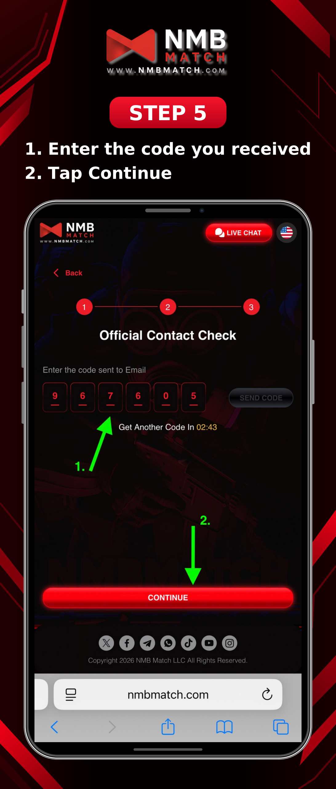
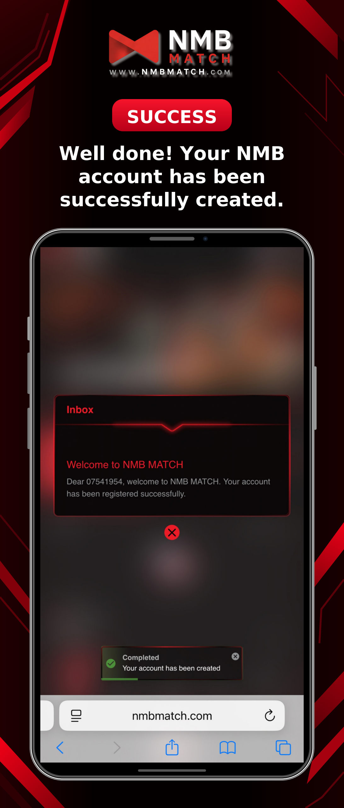

**Screenshot examples:** Use your own account and payment details. Copy wallet addresses from your current account, never from an image. Fees, limits, and available options may differ.

**Before you start:** Have access to your email inbox, your mobile number, and the invitation code you will use to register.

## Step 1: Open account registration

On the NMB MATCH sign-in screen, tap **Create Account**.

## Step 2: Enter your email and invitation code

1. Enter your email address.
2. Enter your invitation code.
3. Complete the on-screen verification if prompted.
4. Tap **Continue**.

## Step 3: Complete your account details

1. Enter a password.
2. Enter the same password in **Confirm Password**.
3. Select your country code and enter your mobile number.
4. Read the Privacy Policy and select the agreement checkbox if you agree.
5. Tap **VERIFY N CONTINUE**.

## Step 4: Request a verification code

On the contact verification screen, tap **Send Code**. Check the email inbox for the address used during registration.

## Step 5: Verify your email

1. Enter the verification code you received.
2. Tap **Continue**.

## Step 6: Check the registration confirmation

Look for the welcome or account creation confirmation shown by NMB MATCH. This completes the registration sequence in the guide.

