**Screenshot examples:** Use your own account and payment details. Copy wallet addresses from your current account, never from an image. Fees, limits, and available options may differ.

This tutorial shows selling USDT through Binance P2P to receive INR via UPI. Before starting, confirm that your USDT is available in the Binance **Funding Account** used for P2P and that you have completed the required account verification. Use a receiving payment account in your own name. See [Binance's P2P selling guidance](https://www.binance.com/en/support/faq/detail/360041106311).

## Step 1: Open Add Funds

Open Binance and tap **Add Funds**, following the route shown in the supplied guide.

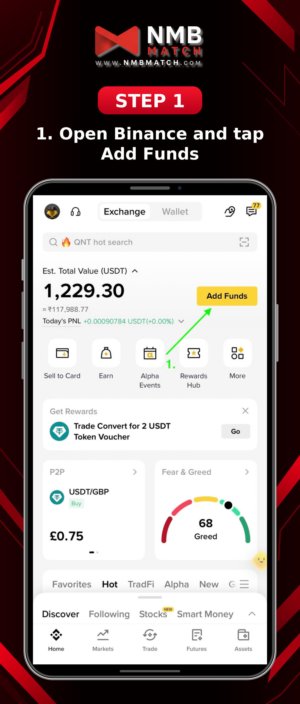

## Step 2: Open P2P trading

Tap **P2P with INR**.

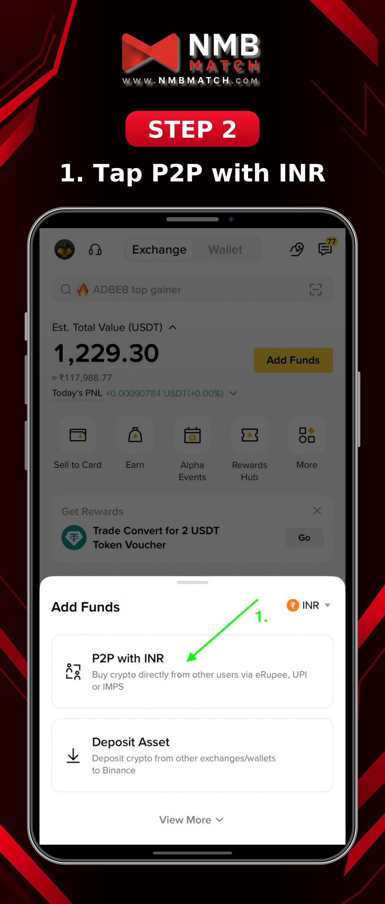

## Step 3: Switch to Sell

Tap **Sell** and confirm that **USDT** is selected.

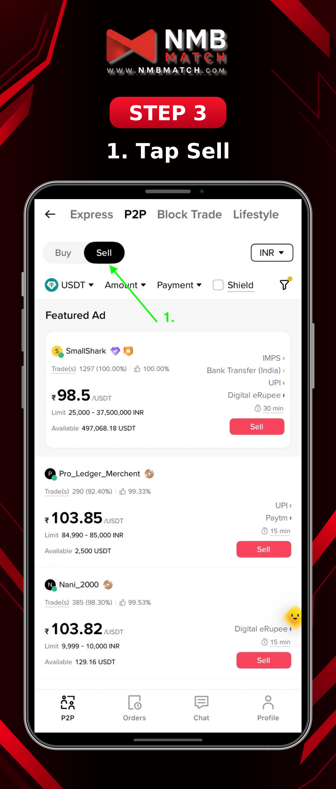

## Step 4: Open the payment filter

Tap **Payment** to choose how you want to receive payment.

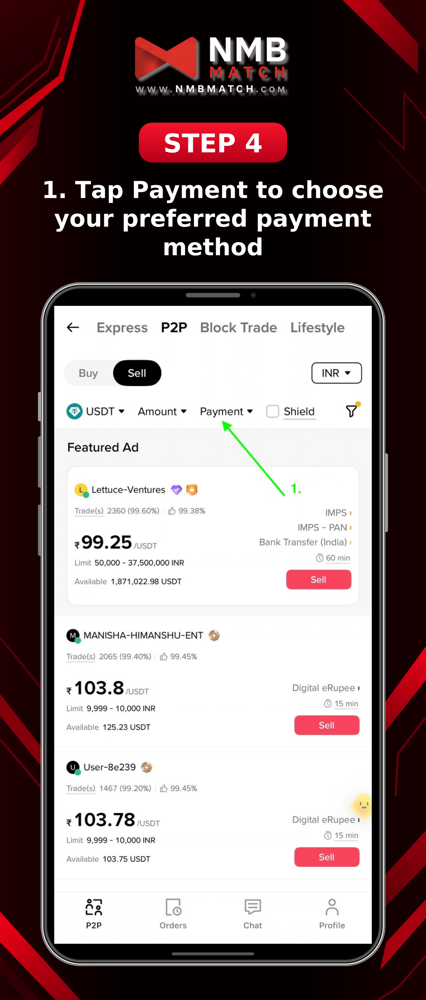

## Step 5: Choose UPI

Select **UPI**, then tap **Confirm**.

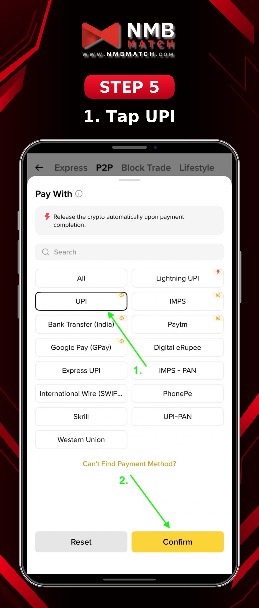

## Step 6: Open additional filters

Tap the **filter icon**.

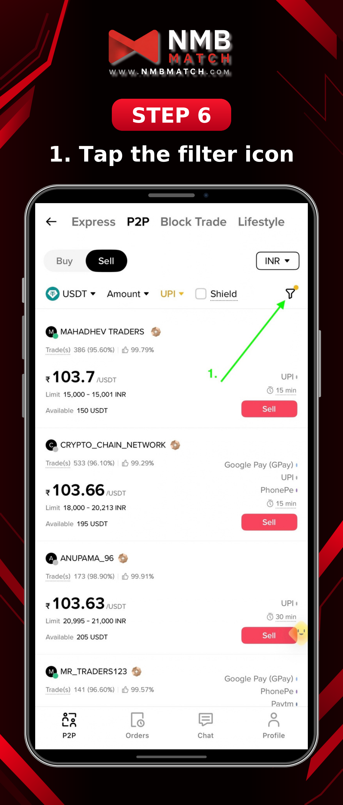

## Step 7: Set your sale filter

1. Enter the amount to filter by, using the currency or unit shown in the field.
2. Apply any relevant buyer filters.
3. Tap **Confirm**.

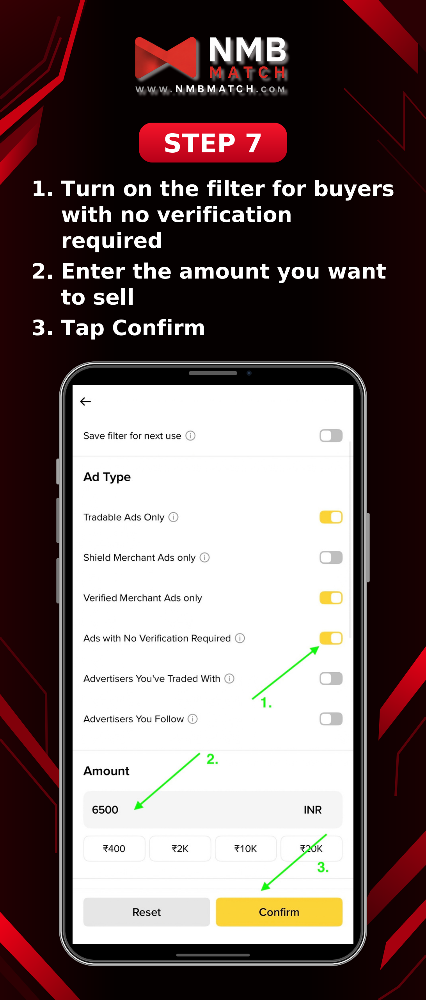

## Step 8: Choose a buyer

Review the buyer's offered price, trade limits, payment method, and terms. Tap **Sell** on the listing you choose.

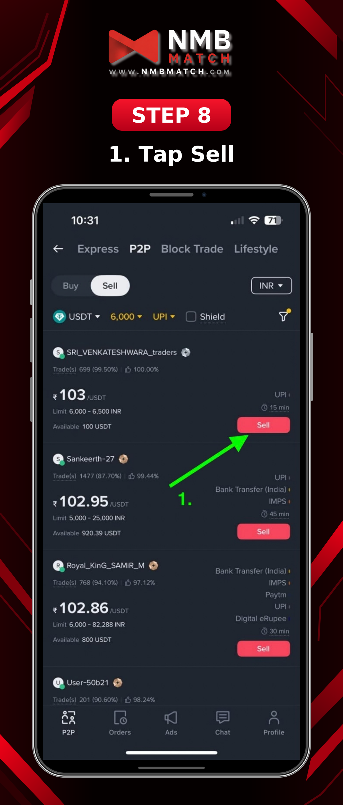

## Step 9: Enter the amount and receiving method

1. Enter the amount you want to sell. Check whether the form is using a USDT quantity or an INR amount.
2. Open the receiving payment method selector.

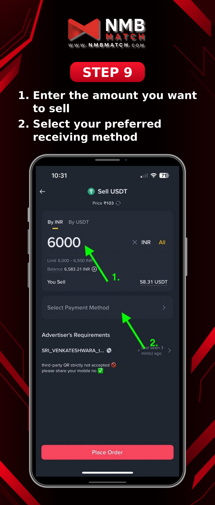

## Step 10: Select UPI as the receiving method

Choose **UPI**. If your payment method is already saved, select it; otherwise, add it as shown next.

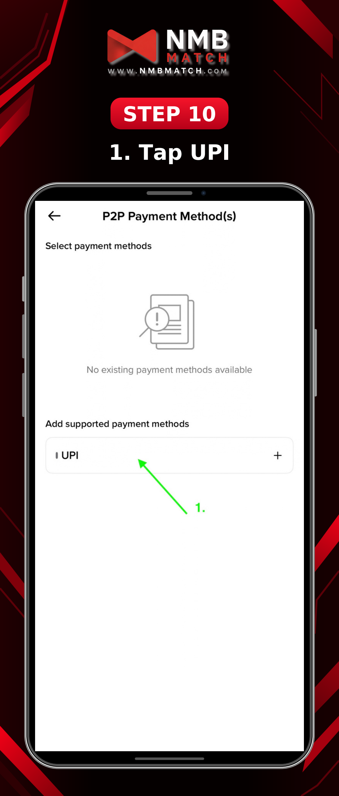

## Step 11: Add your UPI details

1. Enter your own **UPI ID**.
2. Upload your **UPI QR code** if you want to provide it. The supplied form labels this upload as optional.
3. Check that the details are correct, then tap **Confirm**.

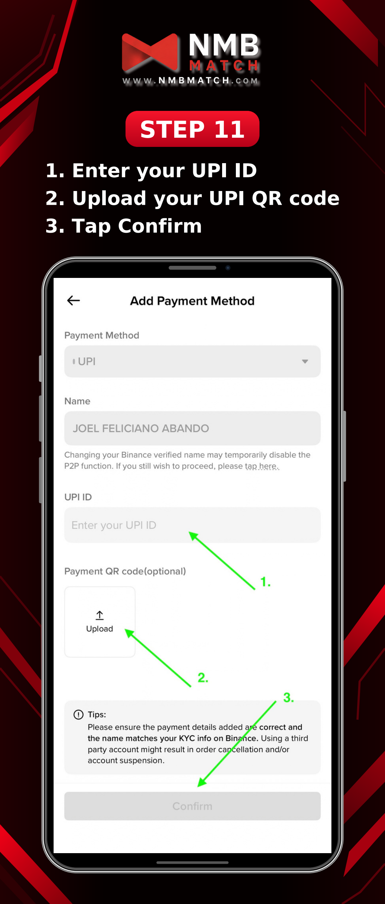

## Step 12: Place the sell order

Once your receiving method is added, review the amount and payment details. Tap **Place Order**.

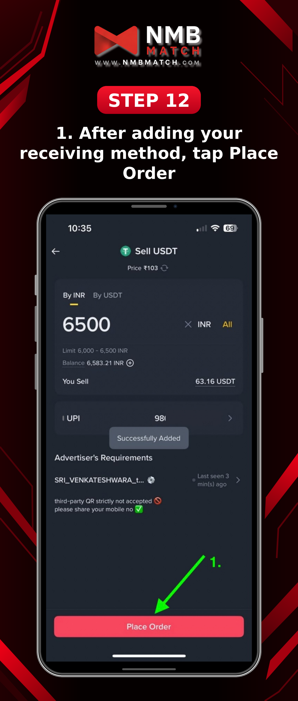

## Step 13: Verify payment before releasing USDT

1. Wait for the buyer to make the payment.
2. Open your own bank or UPI-linked account and verify that the full, correct amount has actually been credited. Do not rely only on the buyer's screenshot or a message saying payment was sent.
3. Only after confirming receipt, return to Binance and tap **Payment Received**.
4. Complete any release confirmation and security verification Binance requires.
5. Check that the P2P order is completed.

If the payment has not arrived or the details are incorrect, do not release the USDT. Use the order's appeal or support options. [Binance explains the payment confirmation and release checks here](https://www.binance.com/en/support/faq/detail/360041106311).

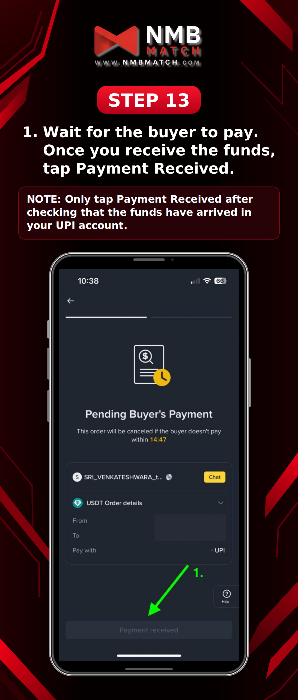
