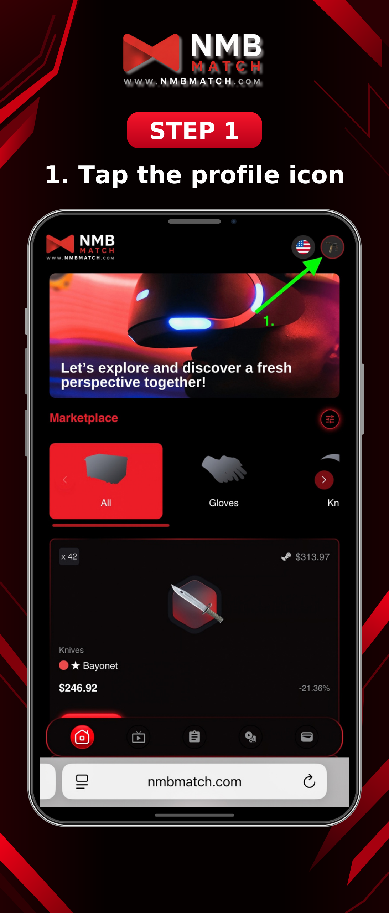
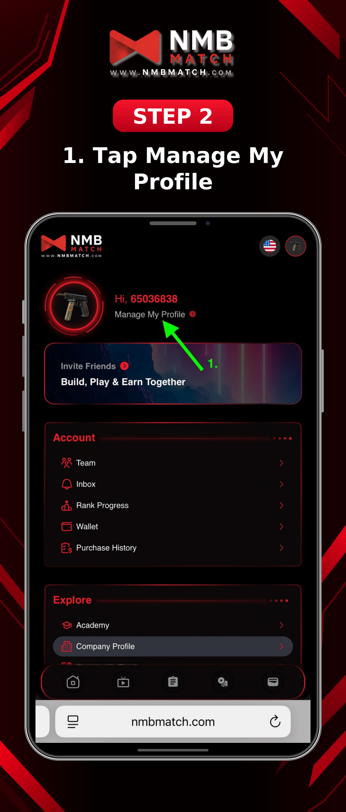
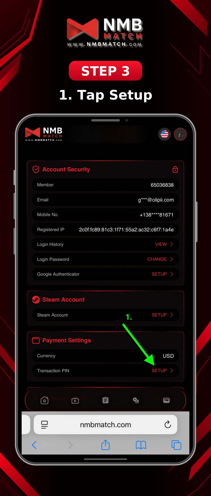
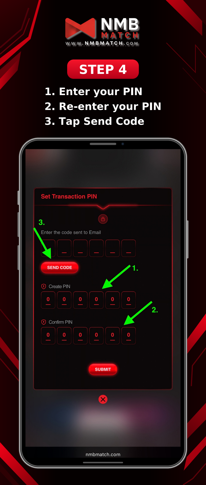
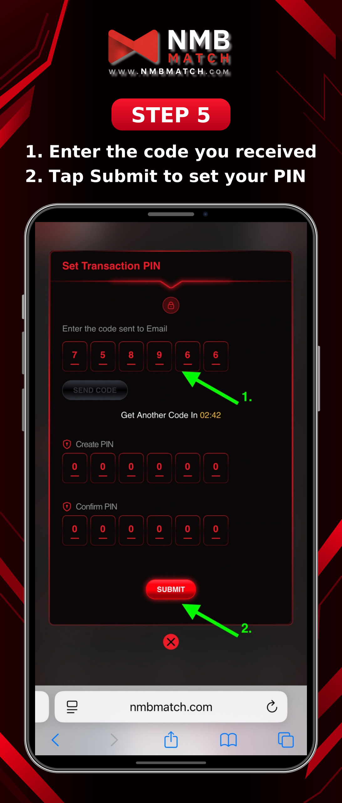

**Screenshot examples:** Use your own account and payment details. Copy wallet addresses from your current account, never from an image. Fees, limits, and available options may differ.

Set up your transaction PIN before submitting a withdrawal. Keep this PIN private and follow the format required by the form.

## Step 1: Open your profile

Tap the **profile icon** in NMB MATCH.

## Step 2: Open profile management

Tap **Manage My Profile**.

## Step 3: Start PIN setup

Under **Payment Settings**, find **Transaction PIN** and tap **Setup**.

## Step 4: Create your PIN

1. Enter your new transaction PIN in the six fields shown.
2. Enter it again in the confirmation field.
3. Tap **Send Code** to request the verification code.

## Step 5: Verify and submit

1. Enter the verification code sent to your email, as indicated on the form.
2. Tap **Submit**.
3. Check for confirmation that the PIN was saved.

